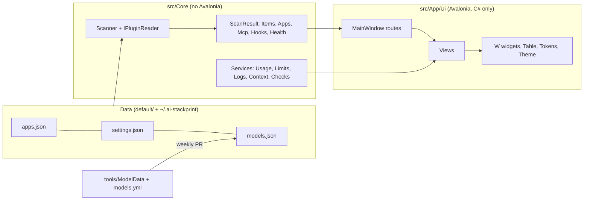

# Feature map

Start here to find the code for a feature without searching. Each row: what the user sees, the route (`MainWindow.Go("<route>")`), the Core services, the UI files, the data or setting behind it, and the tests. Details for each area are in `architecture.md` (search its heading); product rules in `decisions.md`.

## Layers

Rules that shape every change: the scanner is read-only; only `SkillManager`, `PluginManager`, `ConfigEditor`, `LogTrash`, `DataImport` write, after a confirm dialog; Core never references UI; no per-app `if` in `Scanner` (add data to `default/apps.json`).

## Core vocabulary

| Term | Meaning |
|---|---|
| App / `AppDefinition` | an AI tool (Claude Code, Cursor …) described in `apps.json`; `AppInfo` = found on this machine or not |
| Item (`Item`, `Kind`) | one scanned thing: `Skill`, `Plugin`, `Config`, `Command`, `Agent`. Rows of `Command` and `Agent` have a page each (routes `Command`, `Agent`) |
| Level | System, Local, Project, User; always listed in `Levels.Order` (highest priority first) |
| Server | an MCP or LSP server (`McpServer.Kind`); page title "Servers", route `Mcp` |
| Hook | an event handler from a settings or hook file or plugin (`Hook`) |
| Finding | a Health result: warning or guideline (`Health`, `SkillCheck`, `SafetyScan`, `ProjectChecks`) |
| Ctx (`x`) | what a view gets: scan result, `Go`, `Open`, counts, limits, owner window |

## Pages and features

| Feature | Route (nav label) | Core | UI | Data / setting | Tests |
|---|---|---|---|---|---|
| Overview tiles, charts, "Changed since" | `Dashboard` | `ScanDiff`, `Fingerprint`, `ItemAuthor`, `PluginParts` | `DashboardView` (+`.Loading`, `.Plugins`), `PieChart`, `LimitsView.Strip` | `cache/last-scan.json` | `PagesTests`, `RevealTests` |
| App list, group, filters | `Apps` | `AppCatalog`, `Scanner`, `AppFolderProbe` (Add app: what a config folder holds) | `AppsView`, `AddAppDialog` | `apps.json` (custom `custom.` ids) | `PagesTests`, `AppFolderProbeTests`, `DialogChromeTests` |
| One app: plugins, skills, config files, usage, limits | `App:<id>` | `Scanner`, `UsageReport` | `AppDetailView`, `UsageCard`, `LimitsView`, `AppActions`, `DayBars` | `default/apps.json` | `PagesTests` |
| Plugins list + detail | `Plugin` | `PluginReaders*`, `PluginManifests`, `PluginManager` | `LibraryView`, `ItemBrowser`, `DetailPanel`, `SkillFilter` | app's `plugins` field | `PluginReadersTests`, `PluginManagerTests` |
| Skills list + detail, add/remove | `Skill` | `Scanner.Skills`, `SkillManager`, `SkillDoc`, `SkillMatch`, `ItemSearch`, `SearchQuery` | `LibraryView`, `ItemBrowser`, `DetailPanel` | app's `skills`; removed skills go to `backups/skills/` | `ScannerTests`, `SkillManagerTests`, `ItemSearchTests` |
| Commands list, Agents list | `Command`, `Agent` | `Scanner.Parts`, `PluginContents` | `LibraryView(kind "Command" / "Agent")` | app's `commands`, `agents`; plugin `commands/` `agents/` | `ScannerPartsTests`, `PluginContentsTests` |
| Servers (MCP, LSP) | `Mcp` | `McpServers` (+`.Plugins`, `.Toml`) | `McpView`, `SourceCell`, `HoldsCell` | app's `configs` (`kind: "mcp"`) | `McpServersTests`, `McpViewTests` |
| Hooks | `Hooks` | `Hooks` (+`.Kiro`), `HookScript` | `HooksView` | app's `configs` (`kind: "hooks"`) | `HooksTests`, `HooksViewTests` |
| Usage (tokens, cost, days) | `Usage` | `UsageReport`, `UsageStats`, `OpenCodeUsage`, `ModelCatalog` | `UsageView`, `UsageCard`, `DayBars` | app's `usage` parser; settings | `UsageTests`, `UsagePricingTests`, `UsageViewTests` |
| Live limits (opt-in network) | strip on Dashboard, card on app page | `Limits`, `LimitProviders*` | `LimitsView` | Settings › Usage limits, app's `limits` | `LimitsTests` |
| Weekly pace (use vs. even pace, 5-hour pace, forecast) | Plan & limits card on app page | `LimitHistory`, `LimitPace` (`LimitPacing`) | `LimitsView.Pace`, `PaceChart` | `cache/limits/YYYY-MM.jsonl` | `LimitPaceTests`, `LimitHistoryTests`, `LimitPaceViewTests` |
| Tray icon, menu, close to tray, one copy, start at login | tray; Settings › Usage limits › Tray and widget | — | `AppHost`, `TrayHost`, `TrayIconArt`, `TrayNotice`, `MainWindow.Tray`, `SingleInstance`, `LoginItem`, `LimitsTimer` | `trayEnabled`, `closeToTray`, `startAtLogin`; `state.json` `trayNoticeShown` | `TrayWidgetTests` |
| Usage widget | its own window; gear pop-up; Settings › Usage limits › Tray and widget | `WidgetRows` | `UsageWidget` (+`.Rows`, `.Settings`), `TraySettings` | `widget*` settings; `state.json` `widgetPosition` | `WidgetRowsTests`, `TrayWidgetTests` |
| Limit alerts | system notifications (Windows toasts; our pop-up elsewhere) | `LimitAlerts` | `AppHost.Alerts`, `Notifier` (+`.Windows`, `.WinRt`), `AlertPopup` | `alert*` settings; `state.json` `alertsSent`, `alertsPausedUntil` | `LimitAlertsTests`, `TrayWidgetTests` |
| Models and prices; compare 2 to 4 models on radar charts (sizes and prices; Benchmarks) | `Models`, `Models:<name>` | `ModelCatalog*`, `ModelInfo`, `ModelRetirement`, `ModelDataUpdate`, `ModelCompare`, `BenchmarkCompare`, `BenchmarkStore` | `ModelsView` (+`.Compare`, `.Benchmarks`), `RadarChart`, `Dialogs.Model` | `default/models.json`, `~/.ai-stackprint/models.json`, `cache/models.json` | `ModelCatalogTests`, `ModelCatalogEditTests`, `ModelsViewTests`, `tests/ModelData.Tests` |
| Logs list, viewer, search, delete | `Logs`, `Logs:<id>` | `LogReader`, `LogWindow` (the part of a long log shown, moved as you scroll), `LogParts` (a text log's numbered files), `LogParsers`, `ClaudeSessionParser`, `CodexSessionParser`, `LogSearch`, `LogQuery`, `LogSummary`, `LineLogs` (text logs), `SessionGraph` (sub-agent branch layout), `SessionAgents` (Claude Code's sub-agent files merged into the session), `StepReferences` (what a step points at), `Bookmarks` (stars and notes, `state.json`), `SessionExport` (Markdown/HTML, changed files), `LogFolderWatcher`, `LogTrash` | `LogsView` (+`.Files`, `.Watch`), `LogViewer*`, `ReadableLog*`, `LogSummaryCard`, `AgentGraphCell` | app's `logs`; deleting uses the Recycle Bin | `LogReaderTests`, `LogParsersTests`, `LogQueryTests`, `LogWindowTests`, `LogsViewTests`, `LogSearchGoToTests` |
| Health (warnings, guidelines, safety) | `Health` | `Health`, `SkillCheck`, `SafetyScan`, `ConfigChecks` | `HealthView` | none | `SafetyScanTests`, `PagesTests` |
| Project page: context budget, checks, AI folders, Claude settings, export | `Project:<path>` | `ContextBudget`, `ContextRules*`, `ContextBlocks`, `ProjectChecks*`, `AiFolders`, `ClaudeSettings`, `AgentsExport`, `GitIgnore`, `ProjectStore` | `ProjectView`, `ContextSection*`, `ProjectChecksSection`, `AiFoldersSection`, `ClaudeSettingsSection` | `projects.json` | `ContextTests`, `ProjectChecksTests`, `AiFoldersTests`, `ClaudeSettingsTests`, `AgentsExportTests` |
| Edit and view config files | dialogs and bottom panels | `ConfigEditor`, `ConfigJson`, `ConfigSummary` | `ConfigPanel`, `FileView`, `CodeView` (AvaloniaEdit only here), `MarkdownView` | copies to `backups/configs/` first | `ConfigEditorTests`, `MarkdownViewTests` |
| Settings, appearance, colors | `Settings:<page>`, `About` | `SettingsStore`, `FontRuleSet`, `FontRoles`, `StateStore`, `Contrast`, `Oklch`, `VersionedJson`, `JsonLayers` | `SettingsView`, `AppearanceSection`, `FontSetting`, `ColorSettings`, `Theme*` (chart palette: `Theme.LightChart` / `DarkChart`) | `default/settings.json` | `SettingsStoreTests`, `FontRuleSetTests`, `FontSettingTests`, `ThemeTests`, `ContrastTests`, `OklchTests` |
| Export / import of your data | Settings › Export and import | `DataExport`, `DataImport*` | `TransferSection`, `Dialogs.Transfer` | `backups/import-…` | `DataTransferTests`, `TransferDialogTests` |
| Credits (free and open-source projects, licenses, links) | Settings › Credits | `Credits` | `CreditsSection` | `default/credits.json` (a test fails when a NuGet package is not listed) | `CreditsTests` |
| Benchmark scores (Artificial Analysis, your API key) | Settings › Benchmarks, Models page | `BenchmarkUpdate`, `BenchmarkStore` (`cache/benchmarks.json`) | `BenchmarksSection` | off by default; artificialanalysis.ai only; key in `state.json` | `BenchmarkTests` |
| Update check, model data download | Settings › Updates | `UpdateCheck`, `ModelDataUpdate` | `UpdateView` (+`.ModelData`) | off by default; api.github.com only | `UpdateCheckTests`, `ModelDataUpdateTests` |
| Search and command palette (Ctrl+K) | overlay | `ItemSearch`, `SearchQuery` | `CommandPalette` | none | `SearchHighlightTests` |
| Crash report | on next start | `CrashLog`, `CrashReport` | `CrashNotice` | `logs/crash.log` | `CrashReportTests` |
| Scan cache, start-up speed | none | `ScanCache`, `PerfLog` | `MainWindow.Perf`, `MemoryTrim`, `Reveal`, `Busy` | `cache/scan-cache.json`, `logs/perf.log` | `ScanCacheTests`, `PerfLogTests` |

## Model data pipeline (the weekly action)

`.github/workflows/models.yml` (Sundays 12:00 UTC, or Run workflow) downloads LiteLLM's `model_prices_and_context_window.json` at one commit, runs `tools/ModelData` to write **`default/models.json`** (this path; there is no `data/` folder), and opens or updates the pull request `bot/models-update`. The repository must allow Actions to create pull requests (Settings › Actions › General). The app reads the file through `ModelCatalog`; never edit it by hand, change `tools/ModelData` instead.

## Where each kind of change goes

See `recipes.md` for step lists. Quick index: a new app → `default/apps.json`; a new plugin format → `IPluginReader`; a new page → `Ui/*View.cs` + `MainWindow` route and nav + palette + `PagesTests`; a new setting → `default/settings.json` + `Settings`; a new size or color → `Tokens.cs` / `Theme.cs`; list columns → `Cols` in `Table.cs` (`conventions.md`).
